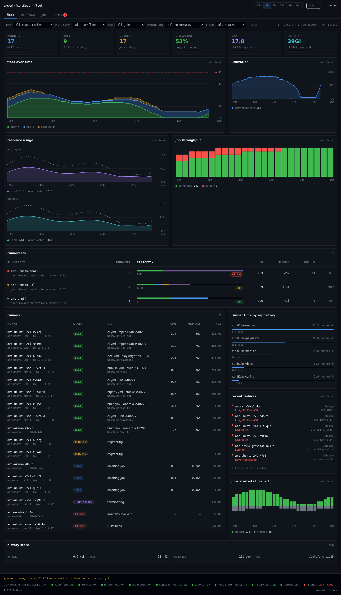
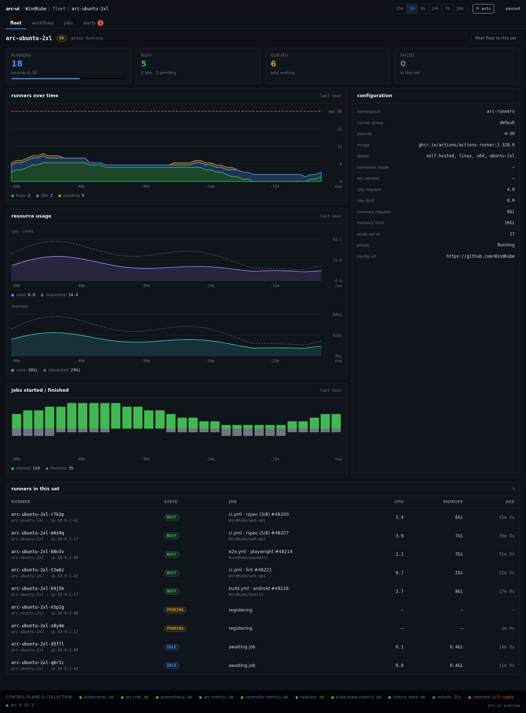
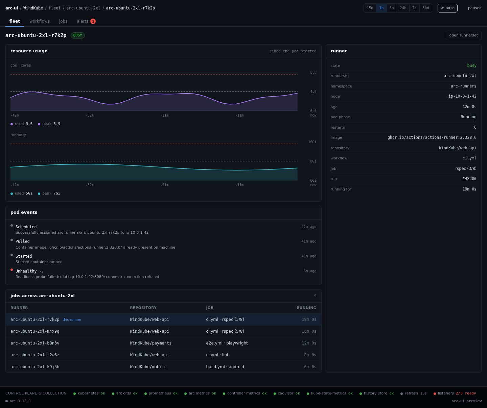
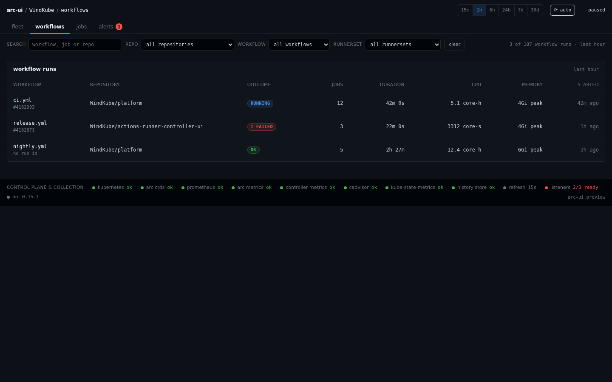
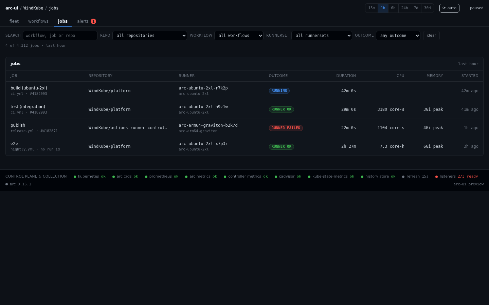
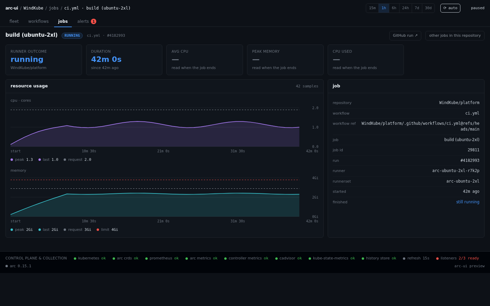
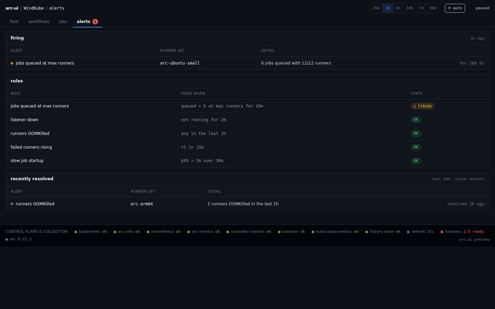

<div align="center">

# Actions Runner Controller UI

**A read-only dashboard for [GitHub Actions Runner Controller][arc] — what every
runner in the fleet is doing right now, what it used, and what happened an hour
ago.**

[](https://github.com/WindKube/actions-runner-controller-ui/actions/workflows/ci.yml)
[](https://github.com/WindKube/actions-runner-controller-ui/releases/latest)
[](https://github.com/WindKube/actions-runner-controller-ui/pkgs/container/actions-runner-controller-ui)
[](go.mod)
[](#rbac)
[](LICENSE)

</div>



## Contents

- [Why](#why)
- [Screenshots](#screenshots)
- [Workflows and Jobs](#workflows-and-jobs)
- [Alerts](#alerts)
- [Requirements](#requirements)
- [Quick start](#quick-start)
- [Configuration](#configuration)
- [Kubernetes](#kubernetes)
- [RBAC](#rbac)
- [Docker](#docker)
- [Development](#development)
- [How it is built](#how-it-is-built)
- [CI](#ci)
- [License](#license)

## Why

ARC tells you a scale set exists. It does not tell you that eleven jobs are
queued behind a set that has been pinned at its ceiling for twenty minutes, that
one runner is being OOMKilled on every attempt, or that the listener stopped
reporting an hour ago. This shows you that.

**It never writes to the cluster.** No scaling, no deletes, no annotations. The
shipped ClusterRole holds `get`, `list` and `watch` and nothing else — see
[RBAC](#rbac) for what is deliberately withheld and why.

**Every data source is optional.** The dashboard boots and serves with
Prometheus unreachable, with the ARC CRDs not installed, and with RBAC missing.
Each failure is reported as a named unavailable source in the footer, never as a
page of confident zeros — a dashboard that renders 0% CPU because it cannot read
metrics is worse than one that says so.

**It is readable before any script runs.** The page is rendered complete on the
server: deep links work, back and forward work, and the whole thing degrades to
plain HTML. [Datastar][datastar]'s only job is keeping it fresh over SSE.

**Auto-refresh is opt-in.** A page load holds no stream open. The `⟳ auto`
toggle beside the range picker is what starts one, and `?live=1` in the URL is
what a shared link or a wall display carries to come back live. Changing a range
or a filter still refreshes what you are looking at either way — with the toggle
off it simply does not leave a connection behind.

## Screenshots

Seven views, each answering a different question. Three are about the fleet
right now, three are about what it already did, and one says what needs a look.

| View | Answers |
| --- | --- |
| **Fleet overview** | how many runners are busy / idle / pending / failed, per scale set, against each set's ceiling — and how much work is still queued |
| **RunnerSet detail** | one scale set over time: capacity, jobs started vs finished, the listener's queue |
| **Runner detail** | one ephemeral runner: CPU and memory since its pod started against requests and limits, the events that explain a stuck pod |
| **Workflows** | which workflow runs went through the fleet, their duration, CPU and memory, and which of their runners failed |
| **Jobs** | every job the dashboard watched, filterable by repository, searchable by name |
| **Job detail** | one job's own CPU and memory over its lifetime against what its runner reserved |
| **Alerts** | what is firing, which rules are unavailable because their source is down, and what resolved |

The fleet overview is the screenshot at the top of this page.

<details>
<summary><b>RunnerSet detail</b> — one scale set over time</summary>



</details>

<details>
<summary><b>Runner detail</b> — one ephemeral runner, with pod events</summary>



</details>

<details>
<summary><b>Workflows</b> — runs that went through the fleet</summary>



</details>

<details>
<summary><b>Jobs</b> — every observed job, with its runner outcome</summary>



</details>

<details>
<summary><b>Job detail</b> — one job's usage against its runner's requests</summary>



</details>

<details>
<summary><b>Alerts</b> — firing, rules, recently resolved</summary>



</details>

These are generated from fixture data, not a live cluster, so they are
reproducible — see [Regenerating the screenshots](#regenerating-the-screenshots).

## Workflows and Jobs

The **Workflows** and **Jobs** tabs are the history half of the dashboard. Both
read only the SQLite store, both are scoped by the range picker, and both filter
by repository, workflow and runner set — with a search box over workflow, job
and repository names.

A **Workflows** row is one workflow run — `(repository, workflow file, run id)`
— aggregated from the jobs observed for it. A run with any failed job is a
failed run. Clicking one opens **Jobs** narrowed to that run.

A **Jobs** row is one job. Clicking one opens its detail view: the runner pod's
CPU and memory from cAdvisor over the job's lifetime, drawn against the requests
and limits it held, plus links to the GitHub run and (with `ARC_UI_GRAFANA_URL`)
Grafana Explore.

### What a job row is, and what it is not

The store holds one row per job, written by watching EphemeralRunners: job id,
workflow run id, repository, workflow ref, display name, runner, set, start, end
and **runner outcome**. The dashboard never talks to the GitHub API, so the
outcome is the runner's ("runner ok" / "runner failed"), not the job's
conclusion: a failing test on a healthy runner is "runner ok". Throughput charts
use `job_result` from the ARC listener metrics instead.

A job's CPU core-seconds and peak memory are read from cAdvisor once, when the
job closes. Rows left open across a restart are closed at the time they were
last seen. Rows are kept for `ARC_UI_JOB_RETENTION` (30 days); at a few hundred
bytes a row the file stays small even for busy fleets.

## Alerts

The dashboard evaluates a few rules every refresh and shows what fires as a
toast and on the **alerts** tab:

| Rule | Source | Fires when |
| --- | --- | --- |
| jobs queued at max runners | listener queue depth, ARC CRDs | a set has queued jobs while at `maxRunners` for `ARC_UI_ALERT_QUEUED_AT_MAX_FOR` |
| listener down | AutoscalingListener and its pod | a set's listener is not running for `ARC_UI_ALERT_LISTENER_DOWN_FOR` |
| runners OOMKilled | live runners and the job store | any runner was OOMKilled in `ARC_UI_ALERT_OOM_WINDOW` |
| failed runners rising | `gha_controller_failed_ephemeral_runners` | a set's failed runners grew by `ARC_UI_ALERT_FAILED_RUNNERS_RISE` in the window |
| slow job startup | `gha_job_startup_duration_seconds` | a set's p95 startup is above `ARC_UI_ALERT_STARTUP_P95` |

A rule whose source is down shows as **unavailable** and holds its alerts as
they were; an outage is never reported as a recovery. State is in memory, so a
restart forgets pending holds and the resolved list. These are not pages: for
paging, write alerting rules in your own Prometheus.

`/metrics` exposes the app itself: `arc_ui_prometheus_query_duration_seconds`,
`arc_ui_prometheus_query_errors_total`, `arc_ui_sse_clients`,
`arc_ui_alerts_firing` and `arc_ui_alert_rule_unavailable`, plus Go and process
metrics.

## Requirements

- A Kubernetes cluster running [Actions Runner Controller][arc] (the
  `actions.github.com` scale-set CRDs, not the legacy `actions.summerwind.net`
  ones).
- Read access to the runner namespaces and to the controller namespace.
- A Prometheus-compatible query API holding ARC's metrics, the kubelet's
  cAdvisor series and kube-state-metrics; see
  [what it needs to hold](#what-prometheus-needs-to-hold). A missing group shows
  as unavailable, not as zeros.

## Quick start

```bash
# Once per checkout: fetch the subcharts pinned in chart/Chart.lock. helm
# refuses to install without them, even with all of them disabled.
helm repo add vm https://victoriametrics.github.io/helm-charts
helm repo add grafana https://grafana.github.io/helm-charts
helm repo add prometheus-community https://prometheus-community.github.io/helm-charts
helm dependency build chart/        # or: task helm:deps

helm install arc-ui ./chart \
  --namespace arc-systems --create-namespace \
  --set prometheus.url=http://prometheus-operated.monitoring:9090 \
  --set env.ARC_UI_NAMESPACES=arc-runners \
  --set env.ARC_UI_CONTROLLER_NAMESPACE=arc-systems

kubectl -n arc-systems port-forward svc/arc-ui 8080:8080
open http://localhost:8080
```

Or run the container straight against a `kubectl proxy` (see
[Docker](#docker) for why the proxy rather than a kubeconfig):

```bash
kubectl proxy --port=8001 &
docker run --rm --network host \
  -e KUBE_API_URL=http://127.0.0.1:8001 \
  -e ARC_UI_NAMESPACES=arc-runners \
  ghcr.io/windkube/actions-runner-controller-ui:latest serve
```

## Configuration

Everything comes from the environment. `internal/config/config.go` is the
authority; this table is it in prose.

| Variable | Default | What it does |
| --- | --- | --- |
| `ARC_UI_HTTP_ADDR` | `0.0.0.0:8080` | listen address |
| `ARC_UI_LOG_LEVEL` | `info` | `debug`, `info`, `warn`, `error` |
| `ARC_UI_LOG_FORMAT` | `json` | `json` or `console`; anything else refuses to start |
| `ARC_UI_NAMESPACES` | `arc-runners` | comma-separated namespaces holding the AutoscalingRunnerSets and runner pods. **Empty means every namespace** (needs cluster-wide RBAC) |
| `ARC_UI_CONTROLLER_NAMESPACE` | `arc-systems` | where the ARC controller and the AutoscalingListener pods live. Not the runner namespace |
| `ARC_UI_PROMETHEUS_URL` | — | **required**. Prometheus-compatible query API base URL; every chart, usage figure and queue depth is a query against it |
| `ARC_UI_PROMETHEUS_BEARER_TOKEN` / `_BEARER_TOKEN_FILE` | — | bearer auth; the file is re-read on every request so a rotated token is picked up |
| `ARC_UI_PROMETHEUS_USERNAME` / `_PASSWORD` | — | basic auth |
| `ARC_UI_PROMETHEUS_HEADERS` | — | extra headers, `k=v,k2=v2` (e.g. `X-Scope-OrgID=tenant`) |
| `ARC_UI_PROMETHEUS_CA_FILE` / `_INSECURE_SKIP_VERIFY` | — | TLS trust |
| `ARC_UI_PROMETHEUS_TIMEOUT` | `10s` | per-query timeout |
| `ARC_UI_PROMETHEUS_SCALE_SET_LABEL` | `name` | the label holding the scale set name on `gha_*` listener series; the listener exports it as `name` |
| `ARC_UI_PROMETHEUS_KSM_SCALE_SET_LABEL` | `label_actions_github_com_scale_set_name` | the same label on `kube_pod_labels` (needs the kube-state-metrics label allowlist) |
| `ARC_UI_PROMETHEUS_PROBE_INTERVAL` | `1m` | how often the expected series are re-checked for the health strip |
| `ARC_UI_REFRESH_INTERVAL` | `15s` | live readings refresh and query cache lifetime |
| `ARC_UI_DB_PATH` | `/data/arc-ui.db` | SQLite history file |
| `ARC_UI_JOB_RETENTION` | `720h` | how long finished job rows are kept (30 days). The store holds only job identity and runner outcome; every time series is in Prometheus |
| `ARC_UI_GITHUB_URL` | `https://github.com` | base for the job page's GitHub run link (set it for GHES) |
| `ARC_UI_GRAFANA_URL` | — | Grafana base URL; when set, job pages link to Explore on the runner pod's cAdvisor series |
| `ARC_UI_GRAFANA_DATASOURCE` | — | Prometheus datasource UID for that link; empty uses Grafana's default |
| `ARC_UI_ALERT_QUEUED_AT_MAX_FOR` | `15m` | how long a set must have queued jobs at its max runners before the alert fires |
| `ARC_UI_ALERT_LISTENER_DOWN_FOR` | `2m` | how long a listener must be down before the alert fires |
| `ARC_UI_ALERT_OOM_WINDOW` | `1h` | an OOMKilled runner in this window fires the alert |
| `ARC_UI_ALERT_FAILED_RUNNERS_RISE` | `3` | fire when a set's failed EphemeralRunners grow by at least this many… |
| `ARC_UI_ALERT_FAILED_RUNNERS_WINDOW` | `15m` | …within this window |
| `ARC_UI_ALERT_STARTUP_P95` | `2m` | fire when a set's p95 job startup is above this… |
| `ARC_UI_ALERT_STARTUP_WINDOW` | `30m` | …over this window |
| `ARC_UI_GITHUB_ORG` | — | breadcrumb label. Empty derives it from the AutoscalingRunnerSet's `githubConfigUrl` |
| `ARC_UI_KUBECONFIG` | — | kubeconfig path. Unset means in-cluster if possible, else the default lookup |
| `ARC_UI_KUBE_CONTEXT` | — | context to select from that kubeconfig |
| `ARC_UI_KUBE_QPS` | `50` | client-go rate limit; must be > 0 |
| `ARC_UI_KUBE_BURST` | `100` | client-go burst; must be > 0 |
| `ARC_UI_SHUTDOWN_TIMEOUT` | `20s` | drain budget: in-flight requests, SSE streams, store close |
| `ARC_UI_PRESTOP_DELAY` | `8s` | keeps serving after readiness flips, so proxies stop routing first. At least twice the readiness period, or clients see 502s |
| `ARC_UI_SENTRY_DSN` | — | Sentry off when empty |
| `ARC_UI_SENTRY_ENVIRONMENT` | `production` | |
| `ARC_UI_SENTRY_SAMPLE_RATE` | `1.0` | |
| `KUBE_API_URL` | — | override the API server address. **Unprefixed on purpose**: it names shared infrastructure, not this app's own setting |

## What Prometheus needs to hold

Every series is read from `ARC_UI_PROMETHEUS_URL`. Four groups of it, each
reported separately in the footer:

| Source | Series | Needed for |
| --- | --- | --- |
| ARC listeners | `gha_assigned_jobs`, `gha_running_jobs`, `gha_*_jobs_total`, `gha_job_*_duration_seconds` | queue depth, throughput, churn, runner time by repository, startup alert |
| ARC controller | `gha_controller_*_ephemeral_runners` | pending runners, failed-runners alert |
| cAdvisor (kubelet) | `container_cpu_usage_seconds_total`, `container_memory_working_set_bytes` | CPU and memory of runner pods and jobs |
| kube-state-metrics | `kube_pod_labels`, `kube_pod_container_resource_requests` | attributing usage and requests to a scale set |

### ARC metrics

ARC ships its metrics off. Uncomment the `metrics:` block in the
`gha-runner-scale-set-controller` chart values:

```yaml
metrics:
  controllerManagerAddr: ":8080"
  listenerAddr: ":8080"
  listenerEndpoint: "/metrics"
```

then upgrade the controller and recreate the listener pods, which is what makes
them pick the flags up:

```bash
kubectl -n arc-systems delete pod \
  -l app.kubernetes.io/component=runner-scale-set-listener
```

Running jobs are unaffected; there is a few-second gap where new job assignments
are not picked up. Confirm the port exists — its absence is how a listener says
metrics are off:

```bash
kubectl -n arc-systems get pods \
  -l app.kubernetes.io/component=runner-scale-set-listener \
  -o jsonpath='{range .items[*]}{.metadata.name}{"\t"}{.spec.containers[0].ports}{"\n"}{end}'
```

Then scrape the controller and every listener on that port. With the
Prometheus Operator, `podMonitors.arc.enabled=true` in this chart renders the two
PodMonitors. ARC runs one listener per scale set, so scrape the pods, not a
Service in front of them.

### kube-state-metrics label allowlist

kube-state-metrics drops pod labels unless they are allowlisted, and without
`actions.github.com/scale-set-name` on `kube_pod_labels` the dashboard cannot
tell which scale set a runner pod's usage belongs to. The chart's bundled
kube-state-metrics (`kubeStateMetrics.enabled`) has this preset. If your cluster
already runs one, add it there:

```text
--metric-labels-allowlist=pods=[actions-ephemeral-runner,actions.github.com/scale-set-name,actions.github.com/scale-set-namespace]
```

In kube-prometheus-stack that is:

```yaml
kube-state-metrics:
  metricLabelsAllowlist:
    - pods=[actions-ephemeral-runner,actions.github.com/scale-set-name,actions.github.com/scale-set-namespace]
```

### No Prometheus

The chart can bring its own: `victoria-metrics-single.enabled=true` installs a
VictoriaMetrics store (30d, 16Gi) that scrapes ARC, cAdvisor and
kube-state-metrics and is wired in as `ARC_UI_PROMETHEUS_URL`.
`collector.enabled=true` adds an Alloy collector that remote-writes into it, or
into any store named by `collection.remoteWrite.url`. For a cluster with no
kube-state-metrics, `kubeStateMetrics.enabled=true` adds a small one limited to
runner pods and the ARC labels. If you already run one, add the allowlist above
to it instead. All three are off by default. Details in
[`chart/README.md`](chart/README.md#no-prometheus-the-bundled-store-and-collector).

## Kubernetes

After the one-time `helm dependency build chart/` from the [Quick start](#quick-start):

```bash
helm install arc-ui ./chart \
  --namespace arc-systems --create-namespace \
  --set prometheus.url=http://prometheus-operated.monitoring:9090 \
  --set env.ARC_UI_NAMESPACES=arc-runners \
  --set env.ARC_UI_CONTROLLER_NAMESPACE=arc-systems
```

[`chart/README.md`](chart/README.md) is the long version. The short version of
what will surprise you:

- **One replica, enforced.** The chart calls `fail` on `replicaCount > 1`: the app
  owns one SQLite file on one ReadWriteOnce volume.
- **`strategy: Recreate`, not RollingUpdate.** A rolling update against an RWO
  volume deadlocks permanently — the new pod cannot attach while the old one
  holds the volume, and the old one is not removed until the new one is Ready.
- **The PVC survives `helm uninstall`** (`helm.sh/resource-policy: keep`), because
  the history cannot be re-derived from anywhere. Reinstalling under the same name
  then needs `helm install --take-ownership` (Helm 3.17+) or a manual adoption;
  the chart README has both.
- **`readOnlyRootFilesystem: true` plus an emptyDir at `/tmp`**, because SQLite
  needs somewhere for temporary files. Remove the mount and queries fail with
  `SQLITE_CANTOPEN`.
- **Liveness is on `/livez`, readiness on `/readyz`, and never the other way
  round.** Liveness pointed at readiness means an API server blip restarts the
  pod, throwing away warm informer caches and forcing a full re-LIST exactly when
  the API server is already struggling.

### RBAC

The ClusterRole is `get`/`list`/`watch` on:

| API group | Resources |
| --- | --- |
| `actions.github.com` | `autoscalingrunnersets`, `ephemeralrunnersets`, `ephemeralrunners`, `autoscalinglisteners` |
| `""` (core) | `pods`, `events` |

Withheld on purpose: `secrets` (ARC keeps the GitHub App credentials there),
`pods/exec` and `pods/attach` (RCE inside a runner), `pods/log` (job logs contain
masked-but-recoverable values), every write verb, and nodes and `metrics.k8s.io`,
since usage comes from Prometheus. The bundled scraper, when enabled, gets its own
ClusterRole with `nodes/metrics` for cAdvisor, never `nodes/proxy`.

The usual misconfiguration is RBAC that covers the runner namespace but not the
controller namespace, where the AutoscalingListeners live: the fleet renders and
every listener shows as unknown.

## Docker

```bash
task docker:build     # docker build -t arc-ui:local .
task docker:up        # dashboard on :8080 + the kubectl proxy sidecar
task docker:down
```

The image is built with the **repository root** as its build context
(`docker build -t arc-ui:local .`), matching what `.github/workflows/ci.yml` and
`release-image.yml` pass (`context: .`, `file: Dockerfile`). Keeping the local
and CI invocations identical means a local build failure is a real build failure
rather than a context mismatch.

The runtime image is `gcr.io/distroless/static-debian12:nonroot`: no shell, no
package manager, no curl. The compose healthcheck therefore calls the binary's own
`arc-ui healthcheck` subcommand — a shell-form command or a curl-based
`HEALTHCHECK` cannot work.

`compose.yaml` documents the per-cluster recipes (kind, Docker Desktop, minikube,
a remote cluster with a static ServiceAccount token) in comments next to the
service they apply to.

### Talking to a cluster from a container

Against a real cluster the reliable path is a local `kubectl proxy`:

```bash
task run:proxy                                      # in one terminal
KUBE_API_URL=http://127.0.0.1:8001 ./arc-ui serve   # in another
open http://localhost:8080
```

Why the proxy rather than just handing the binary your kubeconfig: nearly every
real kubeconfig authenticates through an **exec credential plugin** — `aws eks
get-token`, `gke-gcloud-auth-plugin`, `kubelogin`. client-go resolves those by
executing a binary, and in a container that binary does not exist. `kubectl proxy`
runs on your host toolchain's terms, holds the credential, and re-exposes the API
as plain HTTP. Outside a container the kubeconfig path works fine too
(`ARC_UI_KUBECONFIG` / `ARC_UI_KUBE_CONTEXT`).

> [!WARNING]
> `kubectl proxy` is **completely unauthenticated** — anything that can reach its
> port acts as you, with all your permissions. Local machine only.

## Development

```bash
task install:tailwind         # one-time; templ comes from go.mod's tool directive
task gen                      # *_templ.go + internal/web/static/app.css
task build                    # produces ./arc-ui
task test
task check                    # vet + lint + tests
```

`task --list` has the rest.

### Regenerating the screenshots

The seven views render from fixture data — a fleet under real load, with a
saturated set, an unbounded set, partial metrics coverage, a couple of failed
runners, a window of job history and one firing alert — so the output is reproducible and needs
no cluster.

```bash
task preview        # docs/screenshots/*.html — self-contained, opens from disk
task preview:png    # docs/screenshots/*.png  — what this README embeds
```

The two are separate on purpose: rendering the HTML needs nothing but Go, while
rasterising it needs a browser, and `task preview` should keep working on a
machine that has no Chrome. `preview:png` drives headless Chrome over CDP from
[`tools/screenshot`](tools/screenshot) — its own Go module, so a browser
automation library never enters the application's dependency graph. It uses
`$ARC_UI_CHROME` if set, otherwise an installed Chrome/Chromium, otherwise it
downloads one into its own cache.

Animations and transitions are frozen before each capture, so re-running the task
against unchanged HTML produces byte-identical PNGs rather than a spurious binary
diff. Fonts come from the host, so screenshots regenerated on a different OS will
differ slightly.

## How it is built

- Go 1.26, cobra (CLI), zerolog (logs), caarlos0/env (config), sentry-go
- `k8s.io/client-go` informers over the ARC CRDs and pods, events on demand
- PromQL over the Prometheus HTTP API for every time series and usage figure
- Hand-vendored ARC CRD types in `internal/arcapi/v1alpha1` — ARC does not publish
  an importable Go API module
- gin (HTTP), [a-h/templ][templ] (server-rendered HTML), [Datastar][datastar] (SSE
  live updates)
- ent + `modernc.org/sqlite` (pure Go, so `CGO_ENABLED=0` still gives a static
  binary) for the sampled history
- Tailwind CSS v4 standalone, GitHub Primer dark palette (`assets/input.css`)
- Charts are server-computed SVG: the geometry is decided in Go, which is why the
  preview task exists at all

<details>
<summary><b>Repository layout</b></summary>

```text
cmd/arc-ui/          the CLI (serve, healthcheck, version)
internal/config/     env parsing and validation
internal/logging/    zerolog construction
internal/arcapi/     hand-vendored ARC CRD types, GVRs, label constants
internal/k8s/        informers, collectors, source health
internal/metrics/    metrics.k8s.io polling
internal/listener/   ARC listener Prometheus scrape
internal/fleet/      the domain model: Runner, RunnerSet, Snapshot, Source
internal/store/      ent + SQLite history, rollups and retention
internal/hub/        SSE fan-out
internal/web/        templ views, page assembly, Datastar wiring
internal/chart/      server-rendered SVG charts
chart/               the Helm chart
tools/screenshot/    HTML → PNG for the README (separate module)
assets/input.css     Tailwind v4 entry + the Primer dark palette tokens
docs/screenshots/    generated previews, HTML and PNG
```

</details>

## CI

| Workflow | Trigger | What it does |
|---|---|---|
| `ci.yml` | PR, push to `main` | golangci-lint, `go test -race` with a coverage floor, arc-compat (the vendored types against the pinned ARC release's CRDs), `helm dependency build` + lint + unittest, a kind e2e run, and a container build per architecture that smoke-tests the resulting image |
| `release-drafter.yml` | push to `main` | keeps a draft release up to date from merged PR titles |
| `release-image.yml` | release published, or manual dispatch with a tag | builds and pushes the multi-arch image to GHCR, signs it with cosign and attests its provenance |
| `zizmor.yml` | changes under `.github/`, weekly | audits the workflows themselves for supply-chain issues |

The **kind e2e** job ([`test/e2e/run.sh`](test/e2e/run.sh), `task e2e` locally)
installs the pinned ARC release and the chart with the bundled VictoriaMetrics
store and kube-state-metrics into kind. It then checks that:

- every page serves;
- the app's ServiceAccount cannot write or read secrets;
- the store actually scrapes cAdvisor through `nodes/metrics` and is denied
  `nodes/proxy`;
- `kube_pod_labels` for a pod with the ARC runner labels lands in the store
  with those labels.

**Dependency updates** come from [Renovate](.github/renovate.json5): Go modules,
SHA-pinned actions, Dockerfile base images, the chart's subcharts and the ARC pin
in `internal/arcapi/v1alpha1/arc-version`. Every update waits seven days after
release; vulnerability fixes don't. Dependabot is kept for security alerts only.

`release-image.yml` refuses any tag that is not `vMAJOR.MINOR.PATCH[-prerelease]`,
builds `linux/amd64` and `linux/arm64` on native runners, pushes them by digest
and joins them into a manifest list. A stable release is tagged `X.Y.Z`, `X.Y`
and `latest`; a prerelease gets only `X.Y.Z`. Nobody holds a signing key, so
there is nothing to leak and nothing to rotate:

```bash
gh attestation verify \
  oci://ghcr.io/windkube/actions-runner-controller-ui:<version> --owner WindKube
```

### Version stamping

The released semantic version reaches the binary through the build, not through
the source tree. `release-image.yml` validates the git tag against a semver
regex, strips the leading `v`, and passes the result as the `VERSION` build-arg.
The Dockerfile's build stage links it in:

```sh
go build -trimpath -ldflags="-s -w -X main.version=${VERSION}" ./cmd/arc-ui
```

`-X` can only overwrite a package-level **string variable**, which is why
`cmd/arc-ui/main.go` declares `var version = "dev"` rather than a constant — the
compiler would inline a constant and the linker would have nothing to patch.
From there the value is passed to `web.Builder.Version`, lands on every `Page`,
and is rendered by the footer health strip in `internal/web/layout.templ`.

Two things guard the chain, because every link in it fails silently — a broken
stamp still builds, still runs, and just quietly reports `dev`:

- `ci.yml` builds with `VERSION=0.0.0-pr` and asserts `arc-ui version` prints
  exactly that.
- `release-image.yml` runs `arc-ui version` against the **published** image and
  fails the release if it disagrees with the tag.

The commit SHA and build timestamp are deliberately *not* linked into the
binary. They ship as OCI labels (`org.opencontainers.image.revision` and
`.created`), which is where image metadata belongs and what
`docker buildx imagetools inspect` reads.

## License

[Apache 2.0](LICENSE).

[arc]: https://github.com/actions/actions-runner-controller
[datastar]: https://data-star.dev
[templ]: https://templ.guide
